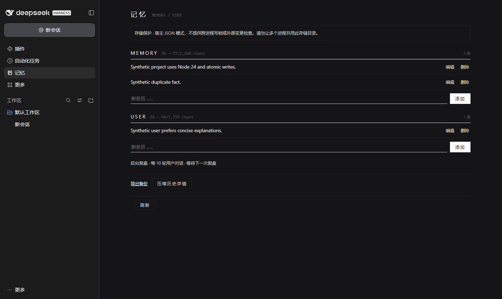

# dsh-hermes-memory

[简体中文](README.md)

An adaptation of [Hermes built-in memory](https://github.com/NousResearch/hermes-agent/tree/c0c4357744d1a6994d332b826aea4c77fcccaf38) for [DeepSeek Harness](https://github.com/deepseek-ai/deepseek-harness), with two bounded memory banks, frozen session snapshots, atomic curation, and periodic background review.

> **Before installing — model usage: the v2.0.0 static bundle enables independent background review by default. Reviews make additional LLM requests and consume model quota; paid models may incur additional charges.**
>
> - By default, a review follows a qualifying response at each multiple of 10 genuine user turns and inherits the triggering turn's model. **In normal operation a review makes 1 additional model request when nothing is worth saving, or 2 when applying a single-bank update**; 16 is the retry and multi-step ceiling, not an expected count, with a default model-loop time budget of 120 seconds. These are limits and a budget, not fixed request counts or prices.
> - To disable independent background review, set `backgroundReview.enabled: false` in the plugin configuration; see the nested YAML example in [Configure background review](#configure-background-review). Main-agent curation and injected memory still consume tokens, so disabling review does not eliminate model usage.
> - Cost depends on the model, conversation length, and actual request count. The bank character budgets do not cap total tokens or cost; see [Resource boundaries](#resource-boundaries-for-extension-authors).

A review may save grounded, durable facts or decide that nothing is worth saving; the number of entries need not grow over time. Background changes to existing entries and deletions become pending proposals that the owner can approve or discard in the Memory panel.

The implementation is based on Hermes commit `c0c4357744d1a6994d332b826aea4c77fcccaf38` (2026-11-11). The primary installation is the **static bundle**. The dynamic sandbox has no native request cancellation controller, so the dynamic deployment provides memory tools, snapshots, and statistics while explicitly reporting background review as `unavailable`. The plugin uses DSH storage and lifecycle services; platform differences are documented below.

## Install and use

Install or enable the bundle in the DSH plugin manager, refresh the existing DSH page, and click **记忆** (Memory) at the bottom of the sidebar. A source installation uses the package directory. For the published package:

```sh
dsh plugin --profile web add dsh-hermes-memory
```

The plugin requires `tools`, `timer`, `sessionProjections`, and a JSON storage backend. The Web profile already includes the storage components; do not declare duplicate storage rows. If storage is unavailable, the plugin returns an error instead of replacing existing data with an empty store.

The implementation verification record covers DSH `0.2.2-alpha.2`, Node `24.22.2`, and the current v4 session format. The package's peer dependency ranges do not guarantee runtime compatibility with every matching version.



The panel follows the interface language selected in DSH settings: Chinese locales (zh, zh-CN, zh-TW, …) show Simplified Chinese and every other language shows English, matching DSH's own English fallback. Hosts without the locale service keep the Simplified Chinese panel. The dynamic statistics card follows the same setting and stays in English without it. Error details returned by the server are shown verbatim. The panel supports Escape to close, trapped Tab navigation, focus restoration to its opener, and entry-specific accessible action names.

### Observe automatic memory

1. State a durable fact during a normal conversation, such as “Use Chinese for all future conversations.” A one-off task requirement does not automatically become a lasting preference.
2. The main model can save memory at any time. By default, background review also runs when the genuine user-turn count reaches a multiple of 10 and that turn completes normally. Tool calls and automatic continuation messages do not advance the user-turn count.
3. Refresh the Memory panel to inspect background status, both banks, and pending changes. By default, background additions can be saved directly (when `writeApproval: true` is enabled, background additions are also staged as pending proposals); changes to existing entries and deletions always require approval.
4. The current session retains the frozen snapshot captured on its first read. New sessions receive updated memory. Use `memory_list` to read the current store during an existing session.

A turn counts at most one genuine user message. A review also requires a genuine user message in the triggering turn, successful turn completion, and a nonempty final text response without tool calls. Cancelled or failed turns, empty responses, and responses with unfinished tool calls do not trigger review; any genuine user message already received in those turns still counts toward the interval. Ordinary subagents do not trigger automatic review. Only one review runs per session at a time; later triggers encountered while it is running are skipped rather than queued for replay.

The review receives only `memory` and `memory_list`. It has no file, network, command execution, or proposal approval tools. A model response without tool calls ends the review, including a decision that nothing is worth saving. The review also stops at the request limit, deadline, model error, or cancellation. Tool calls in a response that hits the output token limit are not executed. Unloading the plugin cancels requests and waits for writes that have already started to settle.

### The two memory banks

| Target | Purpose | Default capacity |
| --- | --- | --- |
| `user` | User identity, lasting preferences, communication style, and explicit standing expectations | 1375 characters |
| `memory` | Environment facts, tool conventions, paths, and stable configuration that apply across tasks | 2200 characters |

Each fact belongs in one bank. Transient progress, completion logs, and TODOs belong in session history. Procedures, techniques, and task-specific preferences belong in skills. This plugin does not automatically modify skill files.

Budgets count Unicode code points, including the `\n§\n` separator between entries; a single `😀` counts as one character. Exceeding the limit does not silently truncate existing entries.

## Call the tools

The model-facing `memory` interface has two required top-level fields: `target` and `operations`. Each call writes one bank. The entire batch and its final character budget are validated before a single durable commit.

```json
{"target":"user","operations":[{"action":"add","content":"The user prefers Chinese for conversations."}]}
```

```json
{"target":"memory","operations":[{"action":"patch","old_text":"Node 24","content":"Node 26"}]}
```

```json
{"target":"memory","operations":[{"action":"remove","old_text":"The complete obsolete entry"},{"action":"add","content":"An updated, stable environment fact."}]}
```

- `add` creates an entry and deduplicates identical text. Leading and trailing whitespace is trimmed.
- `patch` replaces one unique, exact `old_text` span while preserving other facts and whitespace in the same entry. To replace an entire entry, use its complete old text as `old_text`.
- `remove` locates and deletes an entire entry. Exact full-entry matches take precedence, followed by unique substring matches. Entry lookup tolerates common differences in quotes, dashes, and whitespace, but a `patch` replacement still requires an exact, unique stored span.
- A consolidation batch cannot empty a previously nonempty bank. One explicit `remove` may delete the final entry. Removal operations can progressively repair a bank that is already over budget.
- Legacy top-level `action`, `oldText`, and `new_text` inputs remain supported by an internal compatibility layer. The model interface no longer exposes `replace`; the panel retains whole-entry editing.

`memory_list` reads the current banks. `memory_search` performs deterministic keyword matching within the two banks; it **does not search chat history**. `memory_stats` reports capacity, enabled banks, and the pending proposal count. `memory_debug` exposes storage and background diagnostics.

When a write fails, the tool returns an error and, where applicable, the current entries and usage so the model can correct the batch. The first three consolidation failures return the original error; from the fourth failure onward, the result includes `done: true` and an instruction to stop retrying. Main-model failure counts are per session and reset each turn; background review uses a separate count for that review. This instruction does not forcibly reject subsequent tool calls. The background loop remains bounded by its 16-request cap and deadline. A successful commit clears the failure count and explicitly instructs the model not to repeat the saved update. DSH controls any further main-model requests after a tool result.

`memory_pending` only allows the model to list proposals. Approval and discard require the authenticated owner to act in the Memory panel. The model cannot approve its own changes, and the background review has no approval tool. Approval revalidates the current complete matched entry and sequence identity, rejecting a mismatch in either. Approval does not use the panel row-version protocol described below and cannot detect every past change when the same entry identity changes from A to B and back to A.

## Configure background review

Edit the `hermes-memory` entry through the DSH configuration UI or configuration editing service. To disable independent background review while retaining memory tools and snapshots, merge this configuration into that entry:

```yaml
backgroundReview:
  enabled: false
```

**For background review, consider a separate, tested low-cost tool model so an expensive foreground model is not inherited unintentionally.** Set both `provider` and `model` in the same plugin entry:

```yaml
backgroundReview:
  enabled: true
  provider: 'your-configured-provider'
  model: 'your-tested-tool-model'
  maxIterations: 4
  timeoutMs: 120000
```

These names are placeholders: replace them with provider and model IDs already configured in DSH. The selected model must support the `memory` tool and its nested arguments; first check curation quality and context capacity with synthetic facts. `maxIterations: 4` is an optional tighter request limit that can end a review early. Total cost still depends on the model, context, and actual request count; savings are not guaranteed.

Omitting both `provider` and `model` still inherits the triggering turn's model, parameters, and associated costs. Configure both together. If an explicit review model fails, review reports an error instead of falling back to the foreground model; the foreground session's model is unchanged. The compatible default does not select a provider or send conversations to a new provider on the user's behalf.

Full default configuration example (`enabled: true` enables background review):

```yaml
memoryCharLimit: 2200
userCharLimit: 1375
memoryEnabled: true
userEnabled: true
nudgeInterval: 10
contentGuard: true
writeApproval: false
backgroundReview:
  enabled: true
  maxIterations: 16
  timeoutMs: 120000
```

| Field | Behavior |
| --- | --- |
| `memoryEnabled` / `userEnabled` | Disable model reads, snapshots, and writes for the corresponding bank while retaining its stored data for administration |
| `nudgeInterval` | Legacy name for the background review interval in user turns; default 10. `0` disables periodic triggers unless a separate interval overrides it |
| `backgroundReview.interval` | Overrides `nudgeInterval`; `0` disables periodic triggers |
| `backgroundReview.enabled` | Default `true`; `false` disables automatic review while leaving main-model memory writes available |
| `backgroundReview.provider` / `model` | Set both to select a separate review model; omit both to inherit the actual model and parameters of the triggering turn |
| `backgroundReview.maxIterations` | Default 16, clamped to 1–16; maximum model requests per review, not a tool-call limit |
| `backgroundReview.timeoutMs` | Total background model-loop budget in milliseconds; default 120000 (120 seconds). Cancellation still waits for writes that have already started to settle |
| `writeApproval` | When `true`, main-model writes also become pending proposals. Direct owner edits in the panel can still be saved |
| `contentGuard` | Applies a bounded local scan to new content. Existing entries that match the guard are withheld from the injected prompt |

When a different provider or model is selected, the previous model's reasoning effort and output token limit are not imposed on it; the target adapter's defaults apply. The 16-request limit bounds the plugin's model loop. Internal network retries in the host or model adapter are controlled by their own settings and are not counted by this loop. Each review sends the conversation text captured at the trigger and the currently enabled memory banks. Token usage and cost depend on context length, model, and the actual number of requests.

A background error does not fail normal chat. Failure status remains visible. The same claimed trigger is not automatically replayed after reload; a later interval can try again. A successful earlier write is not rolled back if a later review request fails.

### Inspect background review usage

After each review the plugin writes that review's result back into the runtime data (the same storage unit as the memory banks, under `reviews`), including the usage the host reported and the tool-call count:

| Field | Meaning |
| --- | --- |
| `status` | `completed` / `failed` / `interrupted` / `unavailable` |
| `iterations` / `toolCalls` | Model turns and tool calls in this review |
| `writes` / `pending` | Entries written directly, and entries staged as pending proposals |
| `usage` | Host-reported `inputTokens` / `outputTokens` / `totalTokens`; present only when the host reports usage |
| `error` | Failure reason (truncated to 500 characters); `null` on success |

`usage` is recorded only when the host adapter reports usage events. One review record is retained per session (`reviews['session:<id>']`), so this field shows the order of magnitude of a single review; it is **not** a cumulative billing ledger — take cumulative figures from the host's own model-usage accounting.

To estimate your own cost: run a stretch of real turns, take a few `usage` records, scale by the real `interval` against your own turn frequency, then apply your model's price. This documentation does not publish per-unit prices or cost estimates: total cost depends on the model, context length and actual request count, and the bank character budgets cap neither tokens nor cost.

### Resource boundaries for extension authors

“Bounded memory” describes the two curated banks, not a bound on total process memory, disk usage, tokens, or cost. Keep these separate when integrating the plugin:

| Resource | Plugin boundary | Outside that boundary |
| --- | --- | --- |
| Curated bank content | Default `memoryCharLimit: 2200` and `userCharLimit: 1375`, measured in Unicode code points including entry separators; final batches are validated before commit | Prompt framing, tool schemas, conversation evidence, and runtime metadata are not charged to these budgets. Lowering a limit does not automatically truncate existing data; removal-only repairs remain possible |
| Review input | The scheduler captures text from all derived user, assistant, and tool messages available at the trigger; it does not impose an input-size cap or truncate that evidence | `runReview` has an optional reject-only `maxInputChars` argument, but the automatic scheduler does **not** supply it and it is not a deployment configuration field. It measures serialized input with JavaScript string length (UTF-16 code units), not the banks' Unicode code-point count |
| Concurrent reviews | At most one active review per session; overlapping triggers for that session are skipped | No plugin-wide concurrency cap across different sessions. The serialized write queue does not serialize model requests |
| Requests and time | At most 16 model requests per review, configurable downward; a default 120-second model-loop cancellation budget | Not a tool-call, token, cost, or hard end-to-end shutdown limit. Already-started writes are awaited; host/adapter network retries have their own controls |
| Model context and output | Uses the selected model's effective request configuration | Context-window admission, output-token limits, and provider quotas belong to the host/model adapter/provider; they are not guaranteed by bank budgets or the request-count limit |

For integrations needing a strict resource envelope, define input admission, aggregate concurrency, and token/cost policies at the appropriate host boundary rather than assuming the bank budgets provide them. See [`lib/scheduler.js`](lib/scheduler.js), [`lib/review.js`](lib/review.js), and [`lib/core.js`](lib/core.js) for the respective contracts. No additional caps or automatic truncation are enabled by this documentation.

## Storage and recovery

By default, the plugin uses DSH's JSON KvUnit at `~/.dsh/storages/hermes_memory.json`. The first mutation of v1 records writes an atomic v2 global snapshot:

```text
global: { format: 2, tables: { memory, user }, seqHighWater: { memory, user } }
```

The original v1 tables remain as an upgrade recovery copy; subsequent reads use the v2 snapshot. Sequence high-water marks survive deletion and reload so an old proposal cannot acquire a new entry's identity. Existing v2 snapshots without those marks are accepted; retained proposal pins also reserve their sequence identities.

A separate `hermes_memory_runtime.json` stores review claims, outcomes, and pending proposals. Runtime access and recovery require ownership of the main unit, so a second plugin instance cannot take only the metadata unit. On reload, unfinished work is marked interrupted. An approval with an uncertain outcome is not automatically replayed. Any publication error stops further writes until reload and inspection.

### Select storage protection

**Within one plugin instance**, all panel, main-model, and background-review writes share the same `enqueue` queue. Panel `replace` / `remove` also check the complete `oldText`, so an ordinary stale form is rejected after an entry changes from A to B. The panel calls that instance's HTTP routes; it is not a separate file writer. The updated panel also uses [row-version tokens](docs/storage-safety.md#protect-panel-edits-with-row-versions) to reject stale forms after an entry changes back to its original text or is deleted and recreated with identical text.

**Default `host-json` mode can still lose updates when files are shared**: two DSH service/profile processes on the same machine, or separate backend instances, can each cache a snapshot of the same storage directory. The later whole-snapshot write can silently overwrite the earlier update (last writer wins). Manual disk edits during operation can also be overwritten by a later cached write. Duplicate-handle protection within one backend instance does not cover these cases. The pinned DSH JSON backend attempts rename once and has no Windows transient-error retry. The plugin does not retry a whole KvUnit operation because rejection can occur after publication.

Native static installations can opt into a plugin-owned, DSH-format-compatible backend by setting **`storageRoot` to the absolute storage directory**. It acquires one sidecar lease for both files, rejects a second cooperating writer, checks both file fingerprints before publication, and retries only Windows `EPERM` / `EBUSY` / `EACCES` rename failures with bounded backoff. It never deletes the destination to make replacement succeed. See [Storage protection and maintenance](docs/storage-safety.md) for setup, limits, and stale-lock recovery.

Stop every existing writer and back up both files before switching. `storageRoot` selects the plugin-owned directory directly; it is not inferred from private host settings. Do not mix this backend with a host-JSON or older writer on the same files: those writers do not honor its lease. Dynamic sandbox deployments retain host-JSON behavior and cannot enable native protection. Diagnostics report the selected mode; protection is not silently assumed.

### Compact history and export a downgrade copy

The Memory panel (`记忆`) provides **导出备份** (Export backup) and **压缩历史详情** (Compact history details). Export separates current bank entries, complete storage bookkeeping, and a derived v1 JSON document containing the current entries. It includes disabled banks for the authenticated owner and never installs a downgrade. The [offline maintenance command](docs/storage-safety.md#offline-maintenance-and-downgrade) can also export, compact after making a new backup, or extract the v1 document.

Compaction drops old resolved proposal/review payloads while preserving identities, SHA-256 audit hashes, statuses, and per-session claimed-turn high-water marks. Pending, applying, and interrupted approvals retain their full evidence. The panel uses a 30-day cutoff and keeps the newest 100 detailed resolved rows in each collection. Newer rows and unresolved records are also retained. API/CLI callers can select the cutoff and detailed-history allowance.

This bounds retained **eligible old details**, not the number of distinct replay markers or total bytes. No claims are expired or removed, and there is no automatic cleanup. Monitor the runtime file separately from bank budgets; it is still loaded and rewritten as a whole. Do not hand-trim markers or uncertain approvals. Before recovery or downgrade, stop all writers and retain both original files together. v1 cannot read later updates directly from a v2 file: use the exported v1 document in a separate directory, without v2 runtime metadata, and keep your backup.

The panel API uses DSH owner authentication and Host/Origin checks. Responses disable caching:

| Path | Method | Purpose |
| --- | --- | --- |
| `/hermes-memory/stats` | GET | Readiness, capacity, and background status |
| `/hermes-memory/ops` | POST | Read both banks or perform direct edits; list results include pending proposals and background status |
| `/hermes-memory/pending` | GET / POST | List proposals, or approve or discard a specific proposal ID |
| `/hermes-memory/export` | GET | Download current entries, full bookkeeping, and a separate v1 document |
| `/hermes-memory/compact` | POST | Compact resolved details using `before` and `maxDetailed`, retaining replay markers |

An `ops` `list` response retains the `memory` / `user` string arrays and adds aligned `entryVersions.memory` / `entryVersions.user` arrays. The updated official panel captures the row token when an edit or deletion starts and sends it as `expectedVersion` with `replace` / `remove`. Inside the write queue, the server checks both the complete `oldText` and row version. Even identical-text records can be selected independently through their distinct tokens. A conflict returns HTTP 409 with `code: "row_conflict"`, retains the local draft for inspection or copying, and prevents repeated submission of the stale version. Refresh to inspect the latest list, then cancel and start a new edit or deletion. An ordinary refresh does not attach a fresh token to an old draft. Changing a different row does not invalidate an unchanged entry's token. Changing the entry back, deleting and recreating identical text, or reloading the plugin invalidates an old token without adding a persisted format.

Older HTTP calls without `expectedVersion` retain full-old-text checks but lack this ABA protection. The protocol does not cover agent tools or pending approvals. `patch` / `batch` do not support the token and return 400 if `expectedVersion` is supplied. See [Protect panel edits with row versions](docs/storage-safety.md#protect-panel-edits-with-row-versions) for token capture and the full boundary.

The panel keeps `storageSafety` visible. For HTTP 401 / 403, reopen through the DSH login entry. Unknown storage or runtime outcomes (`storage_reload_required` / `runtime_reload_required`) stop writes and require reloading the plugin and inspecting storage; repeated list retries cannot recover them. Retry remains available for retryable service unavailability. Error responses also carry a stable `code` and current storage status. Failed operations preserve the local draft, last successful snapshot, and pending proposals; a retained local draft has not been saved to storage. See [Respond to panel errors](docs/storage-safety.md#respond-to-panel-errors).

## Scope of the adaptation

| Hermes mechanism | DSH implementation |
| --- | --- |
| Two banks, default budgets, independent enable switches, required target, atomic operations | Adapted |
| Frozen snapshots, Unicode code point budgets, unique-span patching, protection against emptying a bank | Adapted with v4 producer-owned message sources |
| Background model review after a qualifying response at each multiple of 10 user turns by default | Adapted as an independent, restricted model loop with at most 16 requests |
| Grounded facts, no inference of user traits from conversation topics, skills take priority for procedural knowledge | Main and background prompts follow the pinned upstream policy |
| Approval for background changes and deletions, with complete original-entry pins | Adapted; only the authenticated owner can approve or discard through the DSH panel |
| External providers, automatic skill maintenance, native `session_search` | Outside this plugin's dual-bank scope; chat retrieval uses host capabilities |
| Native threat scanner | Replaced with a bounded local heuristic adaptation; not claimed to be equivalent, and false positives or negatives are possible |
| File locks and cross-process rereads | Default mode retains DSH single-writer constraints; native `storageRoot` mode adds a shared lease, pre-publish fingerprint checks, and bounded Windows rename retries |
| Full background agent fork | Replaced with an isolated `llm.prepareCall` loop; no new main session and no recursive agents |
| Review counters after a main-session fork | DSH rebuilds the count from inherited history, retaining the parent's accumulated user turns instead of starting from zero for a new agent |
| Background requests in the dynamic VM | Unavailable because the current host exposes no native cancellation controller; use the static bundle |

The [2.0.0 implementation and verification record](docs/2026-11-11_hermes-memory-implementation-report.md) documents validation and platform boundaries in Chinese. The historical [1.2.0 comparison record](docs/2026-11-09_compatibility-and-hermes-report.md) describes that earlier release and is not a statement of current capabilities.

## Develop and verify

The source separates pure rules, prompts, the background model loop, scheduling, and host integration. `host.js` is generated from those modules; do not maintain a second implementation by hand. Read the [contribution guide](https://github.com/isheng-eqi/dsh-hermes-memory/blob/main/CONTRIBUTING.md) before contributing; agents should also read the [agent guidance](https://github.com/isheng-eqi/dsh-hermes-memory/blob/main/AGENTS.md).

```sh
npm run build:host
npm test
npm pack --dry-run
```

Tests against real DSH services require a built checkout. Those tests are skipped when no checkout is specified:

```powershell
$env:DSH_CLIENT_TEST_CHECKOUT=Join-Path $env:USERPROFILE 'deepseek-harness'
node --test tests/*.test.mjs
```

The tests use temporary directories and synthetic data. They cover real v4 encoding, closing and reopening plain JSONL and Zstandard sessions, real JSON KvUnits, native and dynamic VM integration, model adapters, review triggers, concurrency, approvals, and storage failures. Synthetic facts are not written into the actual user memory banks.

Before release, use the [strict pinned-host check](https://github.com/isheng-eqi/dsh-hermes-memory/blob/main/docs/host-release-verification.md), which requires the specified revision, clean sources, rebuilt artifacts, and every test passing with zero skips. Ordinary `npm test` success does not replace this evidence. The generator accepts LF and Windows CRLF checkouts while still rejecting stale dynamic mirrors.

Run these development tools from a source checkout of this repository; they are not included in the installed plugin package:

- [Pinned offline Hermes cases](https://github.com/isheng-eqi/dsh-hermes-memory/blob/main/docs/upstream-compatibility.md): ten traceable scenarios compare selected behaviors. DSH JSON and Hermes Markdown remain different disk formats, and offline tests do not monitor newer upstream changes.
- [Synthetic memory quality scorer](https://github.com/isheng-eqi/dsh-hermes-memory/blob/main/eval/memory-quality/README.md): scores existing outputs; scorer regression success does not establish model quality.
- [Synthetic resource characterization](https://github.com/isheng-eqi/dsh-hermes-memory/blob/main/docs/resource-characterization.md): observes scheduler, review, storage calls and disposal. Its two-million UTF-16-unit cap covers cumulative user evidence across phases, not complete requests or production resource limits.

The main-chat guidance contains 964 Unicode code points. The memory tool description and parameters add approximately 51 characters compared with the previous version. The background-specific review prompt contains 1477 code points and is sent only in review requests; each review request system prompt combines the main-chat guidance, the background review prompt, framing text, and the current enabled memory banks (2542 code points with empty banks). In normal operation, a background review makes 1 model request when nothing is worth saving or 2 requests when applying a single-bank update; 16 is the retry/loop ceiling. These are character counts; actual token usage and cost depend on the model tokenizer, conversation length, and request count.

## License

MIT. Attribution for the original Hermes design, prompts, and rules is recorded in [THIRD_PARTY_NOTICES.md](THIRD_PARTY_NOTICES.md). The SVG icon is original to this project.
